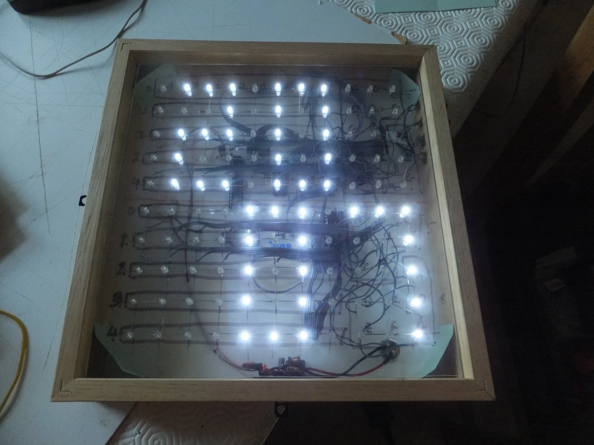
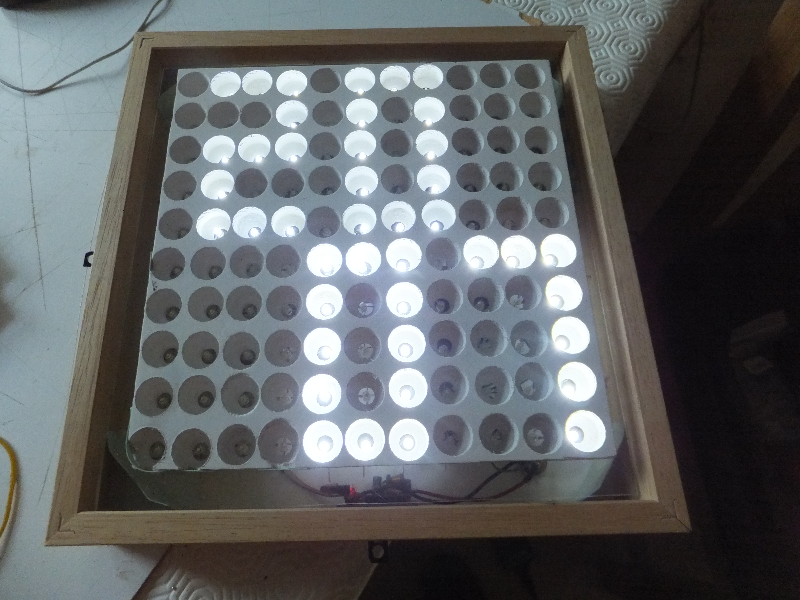
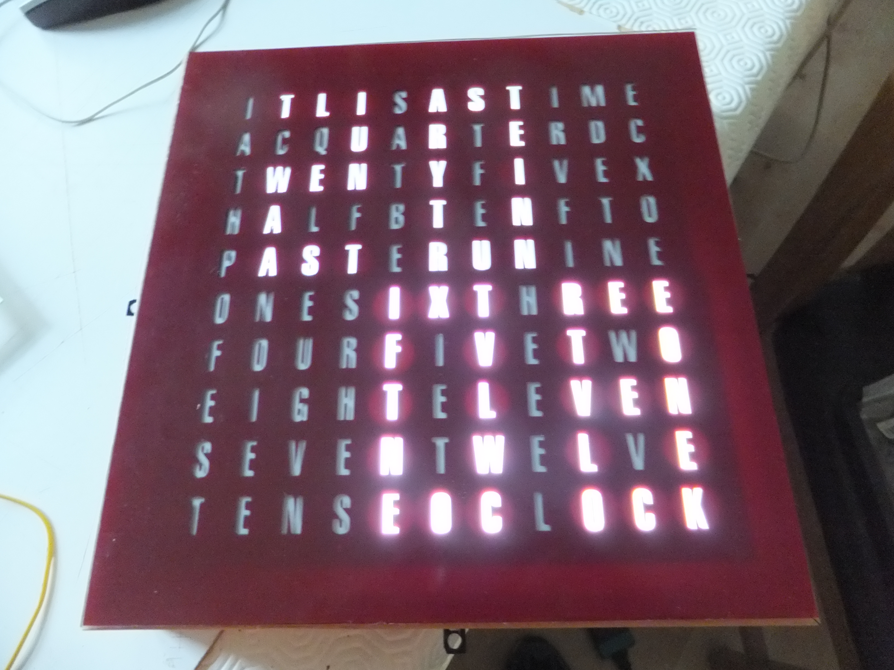
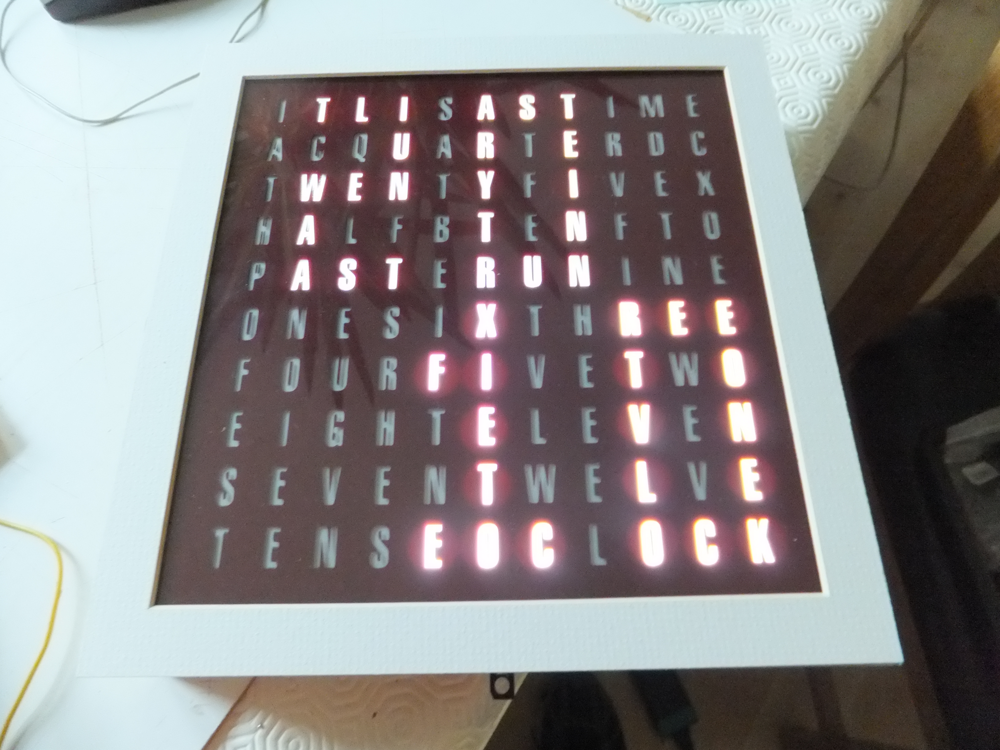

# Word-Clock-v1
The original version 1 of my Word Clock, which uses a PICAXE-M18 microcontroller, and MAX7219 LED drivers to drive the LEDs.

The LEDs were 3mm white (flat top), and placed in to a piece of perspex in which I had drilled all of the 3mm holes.

Over this I used a piece of MDF in which I had drilled large holes (but not all the way through), and then painted it white to provide a reflective surface.

With the letter stencil over the LEDs. I had the stencil made by a company that was able to cut the letters in to a piece of vinyl.

